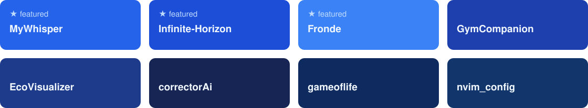
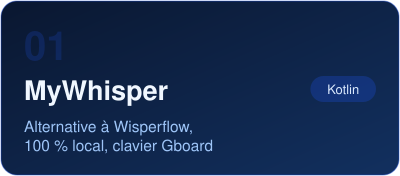
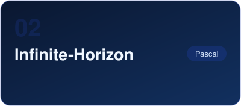
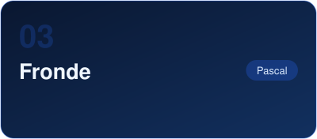

<b>Salut, moi c'est Loïc.</b> Étudiant ingénieur à l'INSA Rouen-Normandie.

## 🧩 Dépôts

  

## 📈 Contributions

  

## ⭐ Projets phares

  
  
  

## 🛠️ Langages

<code>Python</code> &nbsp; <code>Pascal</code> &nbsp; <code>C</code>

